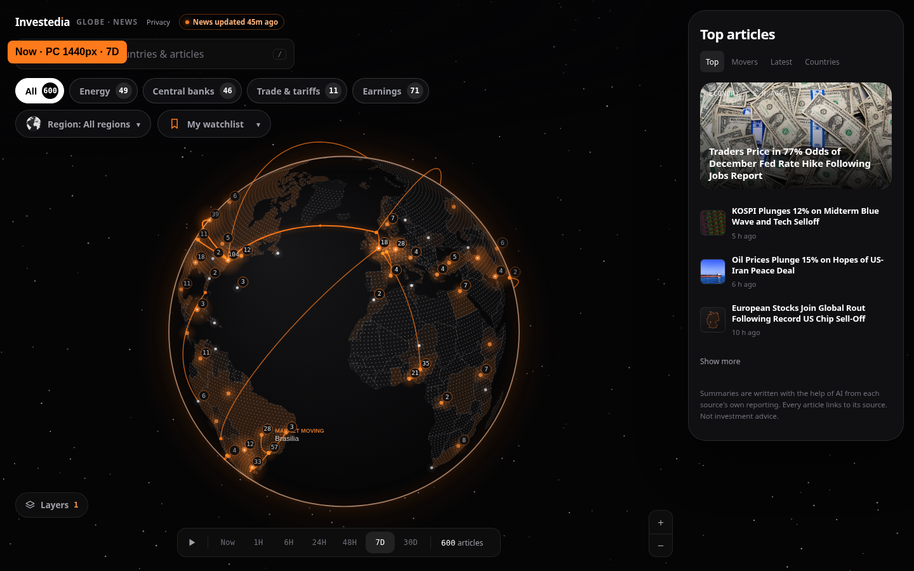
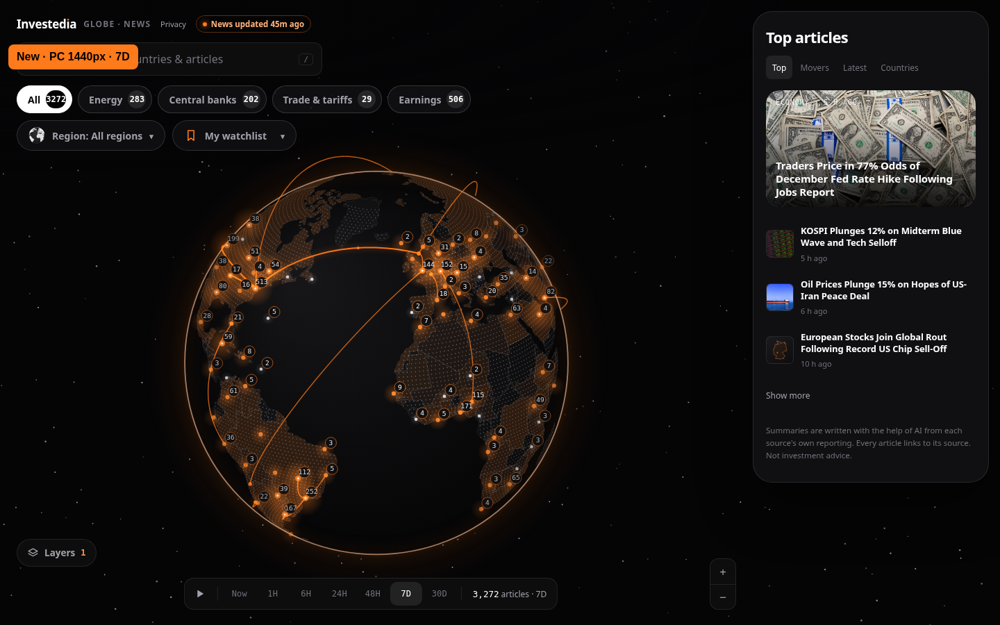
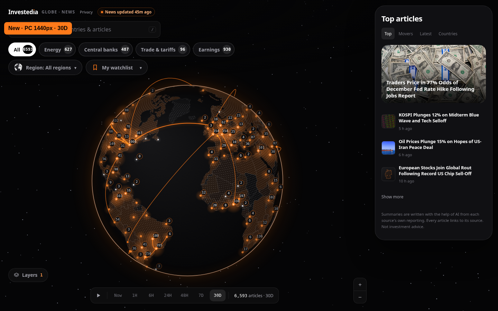
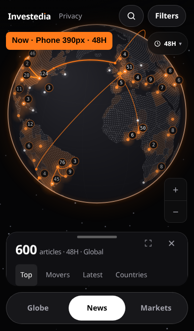
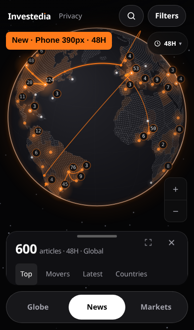
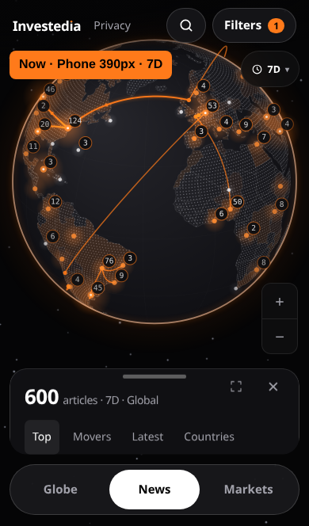
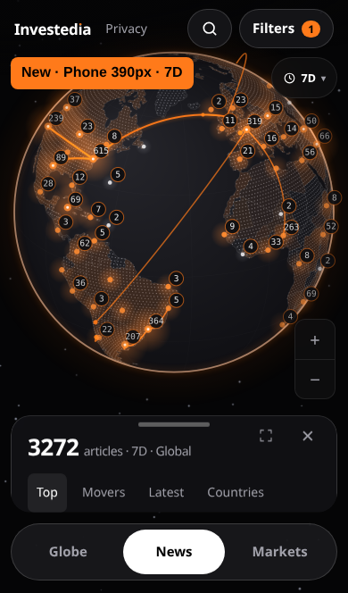
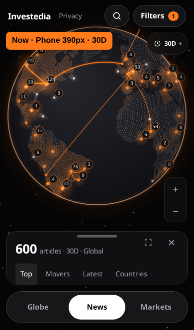
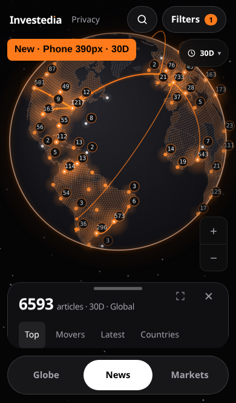

# P0 timeline acceptance evidence

Task: [P0 timeline](../../CODEX-TASK-P0-timeline.md). This task supplies no design mockup. The comparison reference is the unchanged `main` page, labelled **Now**, beside the built page, labelled **New**. No layout, globe geometry, colours or animation changes were requested.

## Reproducible data and measurements

Baseline: `e64ef9199` (`main`). Both servers use that commit's real news/day/connection files. The browser clock is held at **2026-11-06T21:34:11Z**, the 48-hour snapshot's update time, so window boundaries match across runs. Animation timing uses the real monotonic clock. No article content is mocked. Optional external decoration/services are isolated in the functional checks; publisher availability is checked separately.

- PC: 1440 × 900. Phone: Playwright iPhone 13 profile, 390 CSS pixels wide.
- `functional-results.json`: assertions on both devices, counts, earliest timestamps, request URLs, cache and replay checks, console errors.
- `performance-results.json`: iPhone 13, 4× CPU slowdown, alternating 48H/30D/30D/48H. Each segment records 120 animation frames and discards 20 warm-up frames. Both median animation interval and median time executing the globe's frame callback are reported. Run without other browser suites competing for CPU.
- The 30-day window requests 31 overlapping UTC day files. Ten files are absent (before the archive began, plus 17/18 October). Their expected HTTP 404 diagnostics are recorded separately from application errors; they do not interrupt the view. Successful and missing responses are cached.
- Sample original publisher link: event `n3fdac5b5fd`, ECB, 19 October. An independent HTTPS HEAD request followed redirects and returned **HTTP 200** on 6 November 2026. The article panel keeps that exact stored URL, headline and publisher; it explicitly states that no Investedia summary is available.

## Acceptance results

| Criterion | Status | Measured result / evidence |
| --- | --- | --- |
| A1: 7D history | Done | 3,272 articles on PC and phone; oldest 2026-10-30 21:46:37 UTC (6.991 days old) |
| A2: 30D history | Done | 6,593 articles; oldest 2026-10-15 21:45 UTC |
| A3: short windows | Done | Main and New: 24H = 589, 48H = 600, including after loading history; zero daily requests for short windows |
| A4: Play | Done | Seven-day replay; first nonempty frame includes 30 October articles, bounded to the replay start even after 30D was loaded |
| A5: homepage embed | Done | Zero `/events/` requests on PC and phone, including programmatic wider selections |
| A6: unique IDs | Done | 6,593 loaded IDs, 6,593 unique IDs; original live/48H content retained |
| A7: historical article | Done | Exact event headline, publisher, time and URL; explicit no-summary state; original ECB page verified with HTTPS HEAD/GET |
| A8: phone performance | Done | iPhone 13, 4× CPU: median draw 26.7 → 30.0 ms (+12.4%, limit +15%); frame spacing 266.6 → 266.6 ms (+0.0%). 200 sampled frames per window |
| A9: console | Done | Zero application console errors or page exceptions at both widths; ten expected missing-day HTTP 404s handled separately |
| A10: build/regression | Done | Both builds exit 0. All 11 legacy suites passing on main pass here; 208 previously passing browser result rows retained. Python: 125/126 on both; same existing legal-footer failure. Full 31-suite comparison in legacy-regression-results.json |

The focused functional test passes **35 assertions**, including place-cluster cache equivalence, no inferred historical connections, shared day caching, stale selection protection and retry after HTTP 503.

## Visual comparison

No mockup was supplied for this data-loading task; **Now** is unchanged main, **New** is the built candidate. The 48H view intentionally keeps the same article count. The wider-window counts and marker groups visibly differ. Each screenshot prints its label, device and time window.

| View | Now (reference) | New (built) |
| --- | --- | --- |
| PC · 48H |  |  |
| PC · 7D |  |  |
| PC · 30D |  |  |
| Phone · 48H |  |  |
| Phone · 7D |  |  |
| Phone · 30D |  |  |

Historical article: [PC](new-pc-historical-article.png), [Phone headline](new-phone-historical-article.png), [Phone summary/source](new-phone-historical-source.png).

## Data map

| Display/behaviour | Source |
| --- | --- |
| Existing 24H/48H articles | `news-live.json.stories` + `news-48h.json.stories`; existing merge/filter retained |
| History headline, time, source and original link | `events/YYYY-MM-DD.json.events[].title`, `at`, `src`, `url` |
| History location/marker, category, importance, market moving | Event `loc`, `cat`, `imp`, `mm`; passed through the existing normalization/place grouping |
| Window count | Number of unique merged articles passing the existing active filters/time window |
| Replay | Existing seven-second animation across `[now − 7 days, now]`, after the day files load |
| Summary | Event records have none; explicit no-summary state, no generated text |
| Connections | Existing `connections.json` handling; event `assets`/`cos` never create browser-inferred connections |

## Re-run

Serve the unchanged main checkout and the built candidate `docs/` on separate local ports. With Playwright already installed:

```sh
python3 tools/globe-news/build.py && python3 build.py
TEST_BASE_URL=http://127.0.0.1:8782 P0_BASELINE_URL=http://127.0.0.1:8781 node tests/p0-timeline.spec.mjs
TEST_BASE_URL=http://127.0.0.1:8782 node tests/p0-timeline-performance.spec.mjs
```

Set `PLAYWRIGHT_MODULE` / `PLAYWRIGHT_CHROMIUM_EXECUTABLE` when using an external Playwright installation/system Chromium. Evidence output can be redirected with `P0_EVIDENCE_DIR`. The pinned clock requires the same real data snapshot to reproduce these exact counts.

## Not done

None of the P0 acceptance criteria remain unfinished. The 20 pre-existing failing legacy suites (including the one legal-footer Python failure) are documented in the regression comparison and remain outside this task. This branch is for owner review and is not merged.
