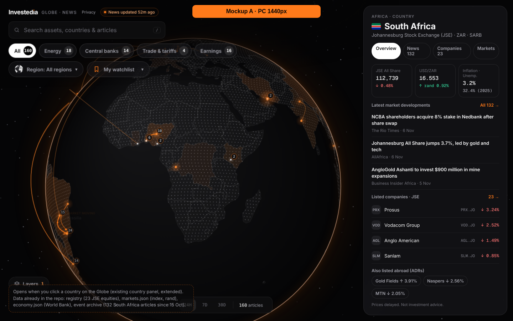
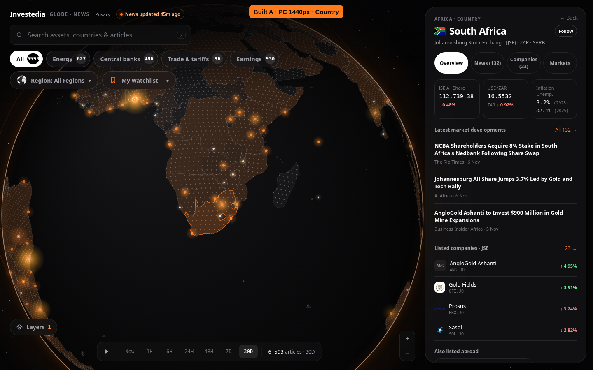
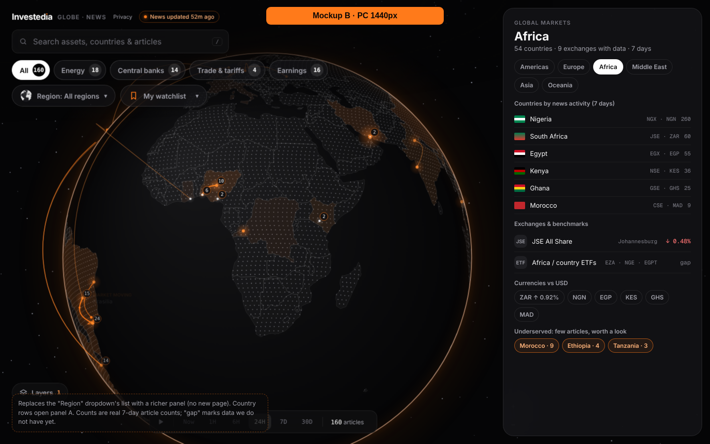
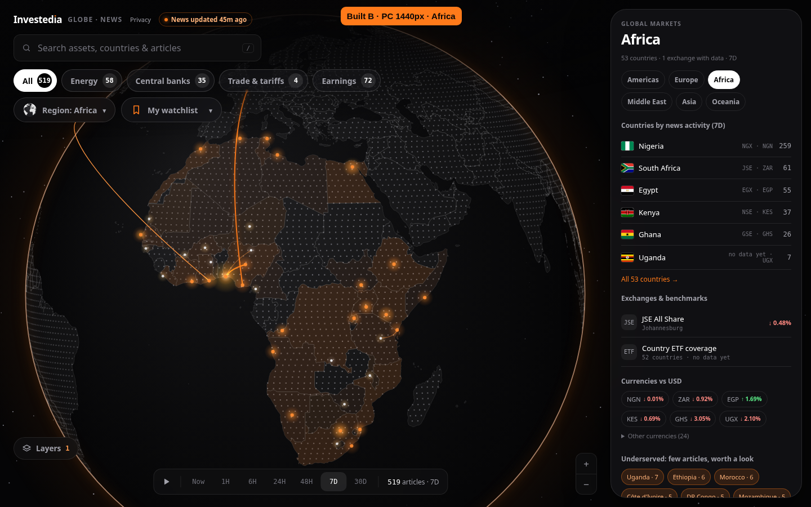
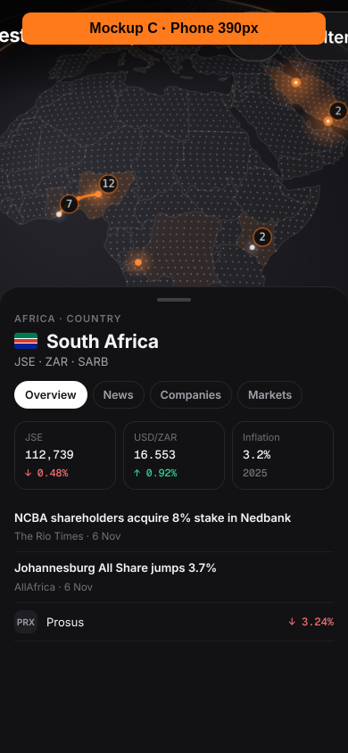
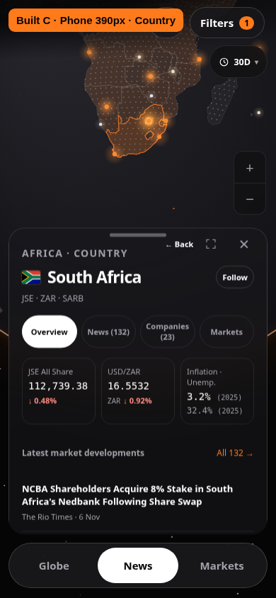
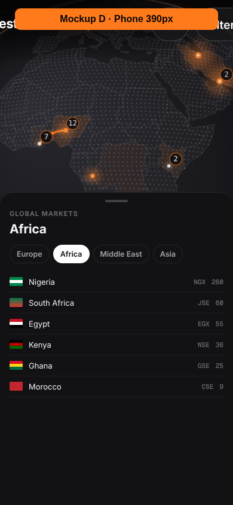
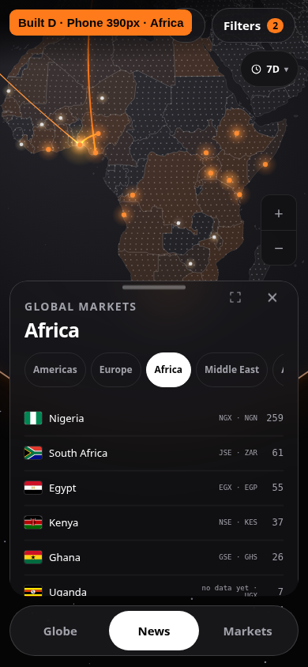

# P1 Global Markets — acceptance evidence

Task: [P1 country markets and continent explorer](../../CODEX-TASK-P1-global-markets.md). Reference layouts: [A](../../global-markets/M-A.png), [B](../../global-markets/M-B.png), [C](../../global-markets/M-C.png), [D](../../global-markets/M-D.png).

The full evidence snapshot was measured on main `d1651e556`, including its upstream heat glow. Before opening the PR, the branch was rebased onto `7f8791d4d`; the builds and focused P1 check were repeated on that integration: **587/587 pass** ([results and refreshed screenshots](integration-7f8791d4d/functional-results.json)). Historical performance and regression measurements below retain their measured base; they are not measurements of the newer renderer. The full routine baseline started at `2319c0628`; affected Globe/P0 suites were rerun after integration, and final phone/performance checks use `d1651e556`. This branch is for review and must not be merged without owner approval.

## Measurements

The functional checks use the committed real files and hold the browser clock at **2026-11-06 21:34:11 UTC**, matching the P0 data snapshot. Animation timing uses the real monotonic clock. PC is 1440 × 900; phone is 390 × 844. Optional external services are isolated using the existing browser test fixtures; no article, company, macro or price content is mocked.

- `functional-results.json`: values compared against files for **ZA, NG, SA, IN, BR**, every company move and listing ID, market day/7-day moves, country news counts, navigation, missing data, console exceptions and phone overflow.
- `exchange-source-audit.json`: **63 MICs**, country/city checked against the official ISO 10383 CSV; currency codes checked against the ISO 4217 list published by SIX. Official exchange and central-bank sources are cited in each exchange record. Website response checks distinguish reachable sources from sites that block automated requests; a blocked HEAD request is not a claim that a source is unavailable to readers.
- `legacy-regression-results.json`: unchanged main and candidate suite results, including pre-existing failures and comparisons of previously passing result rows.
- `p0-performance-results.json` and `main-p0-performance-results.json`: separate iPhone 13 / 4× CPU performance checks, each run without other browser suites competing for CPU. The frame-interval limit passes on both; the additional CPU-draw assertion fails on both (details below).
- `build-results.json`: both required builds and source-data integrity checks.

## Numbered acceptance results

| Criterion | Status | Evidence |
| --- | --- | --- |
| A1 · South Africa PC | Done | 112,739.38 index / ↓ 0.48%; USD/ZAR 16.5532; inflation 3.2% (2025); 23 JSE listings; [A](built-A-country-1440.png), [Companies](companies-ZA-1440.png) |
| A2 · Country phone sheet | Done | Same source values at 390px, no horizontal overflow; [C](built-C-country-390.png), [Companies](companies-ZA-390.png) |
| A3 · Africa PC | Done | Sorted counts independently match source files and the Globe: Nigeria 259, South Africa 61, Egypt 55, Kenya 37, Ghana 26, Uganda 7; [B](built-B-africa-1440.png) |
| A4 · Continent phone sheet | Done | Existing draggable sheet / 390px, six region tabs, country list, retained article list; [D](built-D-africa-390.png) |
| A5 · Five-country source checks | Done | ZA / NG / SA / IN / BR: KPIs, years, all listing IDs and company moves, prices, day/7-day moves, counts and links; [functional results](functional-results.json) |
| A6 · Missing data | Done | Explicit “no data yet”; no NaN / undefined / null in scanned panel modes; [Nigeria](missing-data-NG-1440.png) |
| A7 · Exchange coverage | Done | All 63 required/registry MICs covered; identity/city/country and currency audit; [source audit](exchange-source-audit.json) |
| A8 · Existing Globe behaviour | Done, with shared CPU-check gap | Article opening/back, original region dropdown, filters, 48H/7D/30D and 35 P0 functional checks preserved. The separate extra CPU assertion fails on both main and P1; see “Not done” |
| A9 · Errors/screenshots | Done | 0 application console errors/page exceptions on both widths; expected P0 missing-day HTTP 404s logged separately; [functional results](functional-results.json) |
| A10 · Build/regression | Done | Both builds exit 0; all 12 previously passing routine suites / 208 result rows retained. Full 33-suite comparison includes 21 shared baseline failures, including the extra CPU assertion; [regression](legacy-regression-results.json), [build](build-results.json) |

The focused P1 browser test passes **587 assertions**. All required new panel elements exist; financial values absent from the provided files are marked as missing. The shared CPU assertion is the outstanding validation gap.

## Data map

| Visible element | File → field / calculation |
| --- | --- |
| Country name and flag | Existing Globe map name, `ISO`, existing local flag helper |
| Continent/country coverage | Existing `tools/globe-news/wb-countries.json` region values, with the same region conventions as the news robot; inlined at build time. Count unique mapped countries in the selected region |
| Exchange name, short name, city, currency, central bank | New `data/exchanges.json[MIC]`; public identity facts verified against ISO/exchange/central-bank sources |
| Company count and rows | Existing `data/registry.json.assets`, `class: equity`, grouped by the exchange's ISO country; MIC is the registry's listing MIC (also present in the ID) |
| Company name / ticker | Registry `name`, `sym`, `px`; company directory reused for existing company pages |
| Company logo / destination | Existing logo helper; `data/companies.json.companies[].listings[].s` → existing `company.html?c=<slug>`, otherwise existing `asset.html?s=<price symbol>` |
| Company move / overview order | `markets.json.assets[].d`, matched to that listing and exchange country. Descending absolute move, missing moves last. No domestic-price substitution for overseas listings |
| Also listed abroad | `registry.companies[company].listings`, joined back to registry assets and exchange countries. Only another country's exchange qualifies |
| Benchmark KPI | `markets.json.assets[]`, country `k`, `g: Index`, preferred `m` benchmark; `n`, `p`, `d` |
| Currency KPI / chips | Country FX record in `markets.json` (`t: fx`, `k`), or the shared EUR/USD record for euro-area exchange currencies; `s`, `p`, `d` |
| FX arrow meaning | Source `note`: change measures currency **strength against USD**, including when `p` is an inverse USD/local-currency quote |
| Inflation / unemployment / years | `economy.json.countries[ISO].infl` / `.unemp`: `[year, value]`, displayed to one decimal |
| Latest market developments | Loaded country articles in the current window and active topic/watchlist filters; importance ≥ 2, newest first, at most three |
| Country News count / tab | Same real articles filtered by `location.country`, current window, active category/lens/watchlist; newest first |
| Continent article counts / order | Current Globe `shown`/`activity`, also independently recomputed from live + 48H + daily source files in the test; descending count |
| Exchanges with data | MICs with usable registry-equity quotes or associated country benchmark/ETF data; metadata alone does not count as a price feed |
| Markets tab | Country index, FX and all country ETFs in `markets.json`; `p`, `d`, `w`. Missing values explicitly say **no data yet** |
| ETF fallback / gap | If no benchmark index exists, use a country ETF that actually exists in `markets.json`, labelled **ETF**; missing coverage says **no data yet** |
| Underserved countries | Current window count between 1 and 9 inclusive |

The first six country rows, currencies and underserved countries keep the default panel compact; “All countries”, “Other currencies” and “More countries” expose the remaining real records. The original article list stays below the explorer. The original eight-option Region dropdown remains intact; the six new continent tabs use the same region state, with an Americas view combining North America and Latin America.

## Reference data differences

The mockups are layout references rather than a second price/news source. The built page displays the actual snapshot:

- JSE All Share **112,739.38**, day **↓ 0.48%**; USD/ZAR **16.5532**; ZAR strength **↓ 0.92%**. The reference's upward rand arrow differs from the source's signed `d`; the built page keeps the source value.
- South Africa has **132 articles on 30D**, **23 JSE equities**, inflation **3.2% (2025)** and unemployment **32.4% (2025)**.
- Africa's existing country/region mapping covers **53** mapped countries; the snapshot has **one** exchange with market data. These counts are computed rather than copied from the reference's 54/9 labels.
- The default company rows show the largest absolute moves in the actual file, including positive moves. Overseas chips use verified registry listings; unavailable overseas prices show **no data yet**.
- The host Globe's existing navigation, camera/zoom behaviour and draggable sheet remain. The phone retains its existing dock. Its continent view uses the compact heading from layout D and opens as a partial sheet; expand or scroll to reach every section. The full country/exchange coverage summary remains visible on PC.

## Built versus approved reference

Each image prints Mockup/Built, A–D, and PC/Phone. Country images use 30D; continent images use 7D. Review the panel content against the reference; source data and the unchanged Globe background can differ as described above.

| Layout | Approved mockup | Built |
| --- | --- | --- |
| A · Country · PC 1440px |  |  |
| B · Africa · PC 1440px |  |  |
| C · Country sheet · Phone 390px |  |  |
| D · Africa list · Phone 390px |  |  |

Additional detail views: [Country PC](country-details-1440.png), [phone](country-details-390.png), [Continent PC](continent-details-1440.png), [phone](continent-details-390.png).

Additional views: [23 companies — PC](companies-ZA-1440.png), [phone](companies-ZA-390.png), [Markets — PC](markets-ZA-1440.png), [phone](markets-ZA-390.png), [missing data — Nigeria PC](missing-data-NG-1440.png), [phone](missing-data-NG-390.png).

## Reproduce

```sh
python3 tools/globe-news/build.py && python3 build.py
# Serve docs/ locally, then:
TEST_BASE_URL=http://127.0.0.1:8786 node tests/p1-global-markets.spec.mjs
TEST_BASE_URL=http://127.0.0.1:8786 P0_EVIDENCE_DIR=/tmp/p1-p0-check node tests/p0-timeline.spec.mjs
TEST_BASE_URL=http://127.0.0.1:8786 P0_EVIDENCE_DIR=/tmp/p1-p0-performance node tests/p0-timeline-performance.spec.mjs
```

Use `PLAYWRIGHT_MODULE` / `PLAYWRIGHT_CHROMIUM_EXECUTABLE` when Playwright and Chromium are installed outside the repository. `P1_EVIDENCE_DIR` redirects the focused test artifacts. The pinned clock requires the same real data snapshot to reproduce exact counts.

## Not done

The additional **P0 CPU-draw assertion fails on unchanged main `d1651e556` and its P1 candidate**: main 26.0 → 35.1 ms (+35.0%); P1 25.8 → 31.6 ms (+22.5%), versus its +15% limit. The original median frame-interval gate passes on both: main 233.4 → 266.6 ms (+14.2%), P1 250.0 → 250.0 ms (+0.0%). The earlier pre-rebase measurements are retained in `performance-history.json`. The Globe renderer and performance test were left unchanged; this validation gap is not presented as a passing check.

The other 20 pre-existing failing legacy suites remain outside this task. All 12 routines passing on main still pass, all 208 previously passing browser result rows remain passing, and the 35 P0 functional checks pass. Python retains 125/126 passing tests on both branches, with the same legal-footer failure. Unavailable financial data is explicitly labelled in the panels. This work is not merged.
