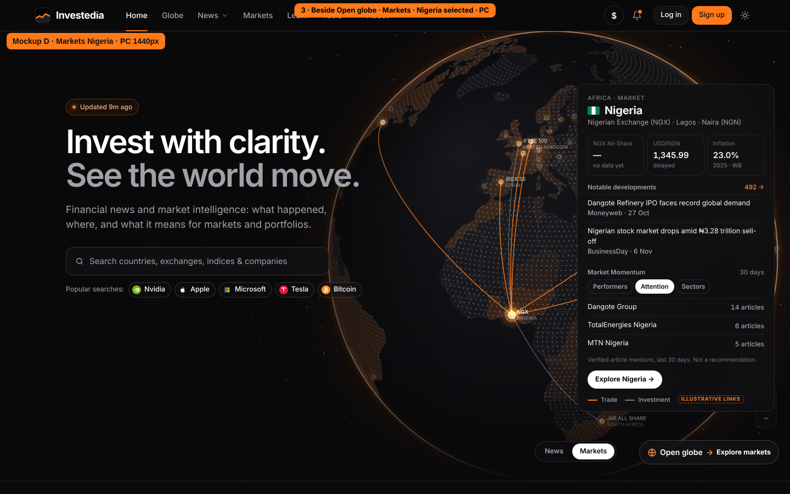
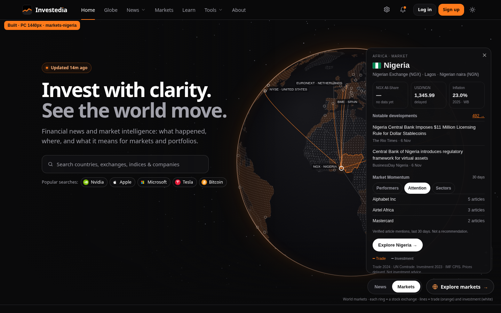
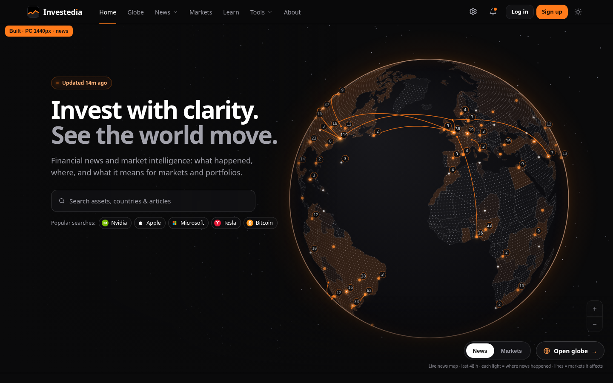
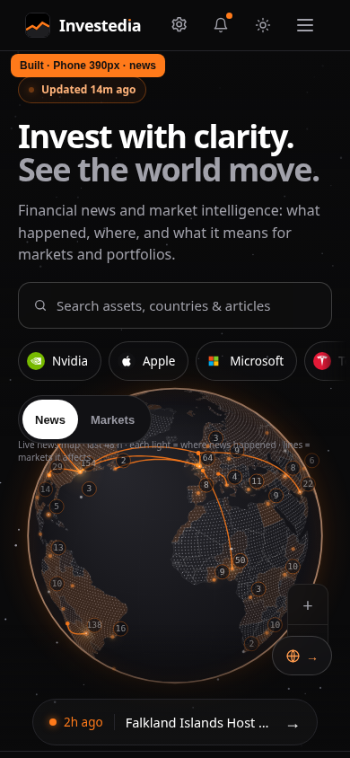
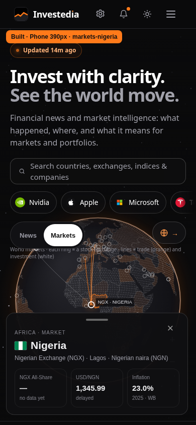

# P4 — Homepage Markets globe and display Settings

[Task](../../CODEX-TASK-P4-markets-globe-and-settings.md) · [approved D](../../markets-globe/D-desktop-markets-nigeria.png).

Initial comparison base: main **`1a72e0045`**, after P1 merged. Final functional screenshots use **`3c5644fc9`** and a browser clock of **2026-11-07 04:12:12 UTC**. The branch inherits main’s updated registry/news and restored number badges; all five affected suites pass on both updated main and P4. Earlier measurements are retained in `measurement-1a72e0045/`. Performance uses the real monotonic clock; its result records the measured base.

## Acceptance results

| Criterion | Result | Evidence |
| --- | --- | --- |
| 1 · Default News / Markets / Nigeria | Done | Default News, URL and iframe mode, rings without unsolicited lines, all selectable rings have sourced city positions. Nigeria has USD/NGN **1,345.99**, inflation **23.0% (2025)**, missing benchmark clearly labelled, 492 country articles in this snapshot, two newest important articles and all three Momentum tabs. Exchange search matches MIC/name/short name/city and retains the selected venue; only that venue and actual line endpoints receive atlas labels. Country-news link opens P1’s News tab at 30D. [PC](markets-nigeria-1440.png), [phone](markets-nigeria-390.png) |
| 2 · Sourced lines only | Done | Every drawn ID/source/year/value matches `market-links.json`; source-response tests verify each of the 20 records. Removing the file yields no arcs. Phone limit **5**, desktop limit **10**; both trade and investment represented. Coverage is deliberately explicit below |
| 3 · Panel / controls | Done | 1440px panel clears both switch and CTA; at 390px the sheet opens at 26% of iframe height and expands to 36%, below the 55% maximum, with a drag handle and keyboard controls. [Phone expanded](markets-nigeria-expanded-390.png) |
| 4 · Atlas labels | Done | Bounding boxes: **0 label overlaps**, no label behind the panel, selected Nigeria label present. Headline/search/control occlusions are also excluded |
| 5 · Currency Settings | Done | Gear visible in both headers; USD values convert on homepage asset sheet, asset page and company page; persistence verified. Local quotes and index levels keep their units, percentages stay unchanged, missing/invalid rates preserve source values |
| 6 · Native Language | Done | Same seven first-party languages as the former footer selector; French and persistence verified; footer Language opens Settings. No translation proxy or external translator |
| 7 · Phone performance | Done | iPhone 13, **4× CPU**, News/Markets/Markets/News, 200 frames per segment. Median interval **200.0 → 200.0 ms (0.0%)**; median drawing CPU **25.9 → 22.6 ms (−12.7%)**. Both within +15%. [Measurements](performance-results.json) |
| 8 · Errors / builds / regressions | Done for P4; baseline failures disclosed | **108/108** focused browser assertions; 0 application exceptions / JS console errors at both widths. Both builds pass; **13/13 main-passing routine suites** retained, **214 previously passing browser rows** retained. The existing 20 failing routine suites remain outside this task. [Results](functional-results.json), [regression](regression-results.json), [build](build-results.json) |

There is one expected HTTP diagnostic per device from the deliberate missing-link-file test. Existing browser fixtures isolate optional external services; the Coinbase WebSocket fixture supplies no quote messages. Article, company, macro and price content comes from the committed files. Currency arithmetic is checked against those rates, including the missing-rate fallback.

## Sources and coverage

`assets/globe/market-links.json` is **12.7 KB**, generated by `tools/globe-news/build-market-links.py` from saved, hashed public source responses:

- **UN Comtrade, annual merchandise exports, Nigeria, 2024, TOTAL HS.** The file keeps the ten largest country partners from 130 positive country records. `primaryValue` is the USD amount; the original reported/estimated indicator is retained. [Public query](https://comtradeapi.un.org/public/v1/preview/C/A/HS?period=2024&reporterCode=566&cmdCode=TOTAL&flowCode=X&partner2Code=0&customsCode=C00&motCode=0&maxRecords=500).
- **IMF CPIS, annual 2023, total portfolio investment, derived Nigerian liabilities.** The ten largest reporting counterpart holders from 46 positive records; direction is **holder → Nigeria**. These are year-end holdings, not flows or FDI. The public DBnomics mirror is a **2025-04-09 snapshot** of IMF data. Each record cites its series, source, year and units. [Dataset](https://db.nomics.world/IMF/CPIS).
- Saved responses and the country-code reference: [`tools/globe-news/market-sources/`](../../../tools/globe-news/market-sources/). The generator runs offline by default; `--refresh` explicitly retrieves public sources. No news robot or schedule is changed.
- **GeoNames city positions**, CC BY 4.0, for Abu Dhabi, Auckland and Pasig City. The three records extend P1’s exchange metadata with coordinates and source links; country/city metadata remains intact. Raw city rows and the downloaded source hash are saved in `exchange-cities.json`. Other exchange positions reuse matching city coordinates in `markets.json`, including accent/city-name normalization. Benchmarks without a matching venue reuse their existing source coordinates. No country-centroid or inferred business-location markers are fabricated.

The bilateral coverage is **Nigeria’s top export partners and portfolio holders**, not an exhaustive world matrix. Selecting a covered counterpart shows its recorded Nigeria relationship. Countries with no recorded bilateral relationship show no lines and an explicit missing-data message. Each visible line remains tied to a real record, with front-facing endpoints only.

## Data map

| Visible item | File → fields / rule |
| --- | --- |
| Mode switch, caption, CTA and search | `src/pages/index.html`: exact requested mode strings; `?mode=markets`, versioned iframe parameter and same-origin message; News default. CTA points to existing Globe in the chosen mode |
| Rings / selected glow | `data/exchanges.json[MIC]`: country, city, short; matching `markets.json.assets[].c/la/lo`, or the three cited `coordinates` records. `g: Index` supplies remaining benchmark locations. One ring per venue; shared-city benchmarks reuse that venue. Country selection defaults to the benchmark city, then the largest registry equity coverage; a ring or exchange search preserves its actual MIC |
| Atlas labels | Exchange `short` + existing ISO country name, 9.5px Inter; only the selected venue and actual connected endpoint venues; projected bounding boxes reject collisions and panel/headline/control occlusions |
| Orange / white links | `market-links.json.links[]`: `id`, `from`, `to`, `kind`, `year`, `source`, `value_usd`, query/series citation. Orange solid trade; lower-opacity white portfolio investment. No data means no line |
| Eyebrow, flag, country | Existing `ISO`, `NAME`, local flags; country quote `r` or article region |
| Exchange line | `exchanges[MIC].name/short/city/currency`; local currency’s name from the existing country FX record |
| Benchmark KPI / move | `markets.json.assets[]`: country `k`, `g: Index`, preferred `m`, `n/p/d`; missing Nigeria index identity uses the approved `exchanges.XNSA.benchmark_name`. Missing → “—” and “no data yet”. Values use tabular Inter, not a currency conversion |
| Currency KPI | Country FX quote `s/p`, original quote units; no percentage or inverse-pair reinterpretation |
| Inflation | `economy.json.countries[ISO].infl`: `[year, value]`; World Bank |
| Developments / N → | Current real `news-live.json` + `news-48h.json`, plus existing available daily event files within 30 days, deduplicated by article ID. Country `location.country`; two newest with importance ≥ 2. N counts country articles in that window; link opens P1 News at 30D |
| Attention | Verified `entities[].asset.id`, or daily `assets[].id` with `src: entity`, joined to `registry.assets[id]` with `class: equity`, grouped by canonical company; count each company once per article. No raw-ticker or headline guesses |
| Sectors | Same verified mentions → registry price symbol → `companies[].listings[].s` → `companies[].sector`; count each sector once per country article. Industry names are not substituted for sectors |
| Performers | No licensed historical-price source is configured; explanatory text, no ranking or invented returns |
| Explore country | Existing P1 country view, `country=<name>&win=30d`; no new page |
| Currency choice / conversion | Existing `inv-prefs` localStorage; cached first-party FX quotes and the existing visible-page Coinbase feed every 30 seconds, when consent permits. Positive ISO currency rates only. USD prices / market values convert; local quotes, FX pairs, index levels and percentages retain units. GBp/ZAc/USX minor-unit normalization preserves the underlying currency. Missing rate → original value |
| Currency display | `Intl.NumberFormat`, proper currency decimals and ISO code on converted values; shared price cells, asset prices/ranges/chart axis, company listings and market-cap displays use the same preference |
| Language | Existing `InvLocale`, `assets/locale.js`, six local language packs plus English, `inv-lang` cookie. Settings uses the same first-party switch. Five new Settings strings are translated in the existing packs |

## Built beside approved reference

The reference’s illustrative lines are replaced with sourced historical relationships. Its named-company examples are replaced with the actual verified counts: **Alphabet Inc 5, Airtel Africa 3, Mastercard 2** in the measured snapshot. No Dangote/TotalEnergies/MTN counts are copied from the image. The current main Globe geometry and lighting are preserved, including its size, rather than resizing it to the older static reference. Part 2 intentionally replaces the reference’s dollar button with the gear.

| View | Reference | Built |
| --- | --- | --- |
| D · Markets / Nigeria · PC 1440 |  |  |
| News · PC 1440 | [Original News reference](../../markets-globe/news-mode-reference.png) |  |
| News · phone 390 | No separate phone mockup supplied |  |
| Markets / Nigeria · phone 390 | Responsive requirement §1.6 |  |
| Settings · PC / phone | Part 2 requirements | [PC](settings-1440.png) · [phone](settings-390.png) |

[Side-by-side D comparison](comparison-D-PC.png). Additional unselected views: [PC](markets-unselected-1440.png), [phone](markets-unselected-390.png). [Expanded phone sheet](markets-nigeria-expanded-390.png).

## Validation and reproduction

```sh
python3 tools/globe-news/build-market-links.py
python3 tests/test_market_links.py
python3 tools/globe-news/build.py && python3 build.py
# Serve docs/ locally, then:
TEST_BASE_URL=http://127.0.0.1:8786 node tests/p4-markets-globe.spec.mjs
# Run performance alone, without competing browser suites:
TEST_BASE_URL=http://127.0.0.1:8786 node tests/p4-markets-performance.spec.mjs
```

`PLAYWRIGHT_MODULE` and `PLAYWRIGHT_CHROMIUM_EXECUTABLE` select an existing external installation. `P4_EVIDENCE_DIR` redirects artifacts; `P4_AS_OF` and `P4_BASELINE_COMMIT` label a different snapshot. Exact article counts require the measured data snapshot. The performance test leaves the **+15%** gates intact and collects 400 frames per mode in ABBA order; CPU drawing and actual animation intervals are both reported.

Regression: 33 routine suites compared on main/candidate, 13 passing on both. All 13 were repeated against the final implementation, including P1’s **587 assertions**. All **214 previously passing browser result rows** remain passing, including two original phone Privacy cases rerun after correcting an intermediate overlay collision. Phone’s existing suite retains **10/11**, P0 retains **32/33 executed assertions** on both; neither failing suite is presented as green. Final Python: **127/128**, including both new provenance tests, with the same pre-existing legal-footer failure. Against integrated main `3c5644fc9`, eight rendering/camera/connection functions match exactly; News frame source differs only by the optional Markets branch. **6,715 existing JSON inputs** and Track Record content are unchanged by P4 against the integrated main (generated asset-version references excluded). [Source integrity](source-integrity-results.json).

Full [changed-file list](changed-files.txt). Shared UI changes require generated root/docs page asset-version updates; these preserve their page content. The homepage and Globe also include the requested UI changes. No new page is added.

## Not done

- Exhaustive global bilateral coverage: the generated baseline covers Nigeria’s largest export partners and portfolio holders. Missing countries/pairs draw no lines. The IMF mirror is explicitly dated; it is not presented as a current investment flow.
- Licensed historical price rankings: no licensed source is configured, so Performers shows the required explanation. Missing Nigerian benchmark prices remain clearly labelled.
- The **20 existing failing routine suites** and legal-footer assertion are not repaired in this P4 task. Full failing-suite output is summarized in `regression-results.json`; all previously passing suites and rows are retained.
- No new phone mockup was supplied; the responsive implementation follows the specified sheet, handle, visible-globe and five-line limits. The existing Globe size/camera is preserved as required, even where the older reference differs.

This is a review branch. **Do not merge.**
